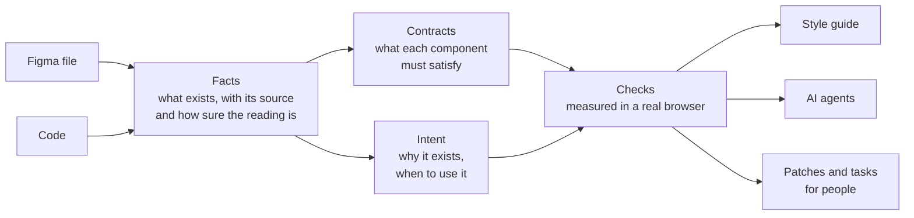

# Technical documentation

How the engine works, how to run it, and what each check does, one page per group of the [features page](features.md). What each part promises, and what to ask Claude Code for it, is on that page.

The complete lists live in the guide Claude reads. Every option is in `reference/usage.md`, every setting in `reference/config.md` and every gate in `reference/gates.md`, with the recipes in `cookbook/` and the short guide in `rms-design-system-engine.md`.

**The pages**

- [Setup](setup.md): how to install the engine, keep it up to date and run it, what it adds to Claude Code, and the files and settings it uses.
- [Audit](audit.md): how the engine checks your Figma library, lints your code and compares Figma with the code.
- [Accessibility](accessibility.md): how the engine tests the accessibility of every component, and of your products' pages, in a real browser.
- [Documentation](documentation.md): how the engine writes each component's contract and gathers the intent layer.
- [Collaboration](collaboration.md): how the engine publishes the living style guide and the playground.
- [Creation](creation.md): how the engine builds prototypes with your real components.
- [Security](security.md): what the engine reads, sends and may change, and why it can be trusted with a team's code.
- [Working on the engine](development.md): for whoever changes the engine itself.

## How it works

Facts, contracts and checks are measured, never guessed by a model. AI drafts the intent layer and builds with the system, and the checks judge what it builds. When something cannot be read or run, the result says so instead of passing.

**One request, start to finish.** You ask Claude Code to check the button. The engine reads the button from Figma and the code, takes the components inside it along, and measures it in every state and colour mode. Each difference names its rule, the file and line, the value to write there and who fixes it. Code people wrote comes back as a patch to apply, never changed, and a change to Figma waits for a yes. The button's page in the style guide shows the same result.

- **It reads Figma precisely.** What your design system really defines, the tokens and each component's parts, states and options. It is not a "does this look like Figma?" screenshot comparison.
- **It reads your code the same way.** Once per run it opens your pages in a browser and records what the code really produces, every token in every mode, each component's sizes, states, props, icons and markup, and which components sit inside which.
- **Every fact has a source.** Each one says where it came from and how sure the reading is. When something cannot be read reliably, the engine says so instead of blaming the design.
- **It writes the facts out for AI tools.** A catalog of your real components, their options and which go inside which, so AI tools build with the real system instead of guessing. `--check-ui` checks what they generate against it, every time, without changing it.
- **It pairs each Figma component with its code file.** One shared pairing (`component-pairing.mjs`) answers for every check, the style guide and the router, so they all agree. Details below.

The whole flow, step by step, is on the [FigJam board](https://www.figma.com/board/W5UEjkrLv5t4fqsGPQWqk8/rms-design-system-engine-flow?node-id=0-1).

### Which code file is each Figma component

Each sign the code gives counts. A strong sign pairs on its own. A weak one needs a second sign that agrees.

| Sign | Strength | Example |
| --- | --- | --- |
| File name | Strong | `Button.vue`, `button-primary.tsx` |
| Name it declares | Strong | `name: 'buttonPrimary'`, `function ButtonPrimary` |
| Class on its first element | Strong | `.button-primary` |
| Folder and file name | Strong | `buttons/Secondary.vue` is buttonSecondary, `card-box/index.vue` is cardBox |
| Only file with its selector | Strong | the one file that holds `.chip` |
| Generic file name | Weak | `switches/General.vue` is switch (also Default, Base, Main, the only file in a folder, and `cards/Primary.vue` when Figma has no cardPrimary) |
| Library prefix | Weak | `HbBadge.vue` or `.hb-badge` is badge |
| Tokens | Weak | a file using `var(--advanced-tooltip-bg)` is tooltip's, read through the tokens snapshot and your naming convention |
| State word | Weak | tooltipOpen and tooltipClosed are both `Tooltip.vue` |
| Props | Backs another sign | its props hold two thirds of Figma's properties |

- **Paired.** A strong sign, or two that agree.
- **Proposed.** One weak sign alone. Never applied: the audit prints it (`🔗`), the props and sub-component checks name it in their "no code file" line, and the style guide lists it on the Status page, under Parity, to confirm or pin.
- **Only in Figma.** No sign at all. The files nearest its name are named, among those no other component has.
- **Never taken twice on a weak sign.** A file a name gives to one component is not offered to another on its tokens alone, unless the two differ only by a state word.
- **One file, two styles.** When Figma has bannerTopPrimary and bannerTopSecondary and the code has `banners/Top.vue` with a prop that chooses the style (`useSecondaryStyle`), both are paired with it.
- **`componentFiles` always wins.** It pins a pair by hand in `ds-config.json`.
- **Its class.** With no `componentSelectors` or contract selector, a component's class is the one its paired file writes for its name, else the class of that file's first element. A file named after the component keeps the convention's class (`.chip` for `Chip.jsx`).
